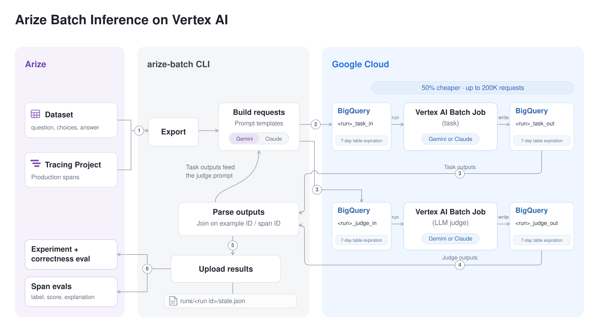

# Arize experiments and evals with Vertex AI batch inference

Run large experiments and LLM-as-a-judge evaluations through **batch inference on Vertex AI** with Gemini or Anthropic Claude models (50% of the real-time price), then record the results in Arize as a normal experiment or as span evaluations.



The 7-day table expiration in the diagram is a recommended setting on `BQ_DATASET`, not something the tool configures (see [BigQuery tables](#behaviour-worth-knowing)).

Two commands:

| Command | Input | Result in Arize |
|---|---|---|
| `arize-batch experiment` | An Arize dataset | A new experiment on the dataset: one run per example, plus a judge eval per run |
| `arize-batch span-evals` | Spans from a tracing project | An eval (label, score, explanation) on each span |

BigQuery is used for batch input and output. The Arize example ID or span ID travels with each request (as an extra column for Gemini, as `custom_id` for Claude), so results join back exactly.

## Setup

Requirements: Python 3.12+, [uv](https://docs.astral.sh/uv/), and the `gcloud` CLI.

```bash
uv sync
cp .env.example .env        # then fill it in
gcloud auth application-default login
```

Google Cloud needs:

- The Vertex AI API enabled in `GOOGLE_CLOUD_PROJECT`, and a model that supports batch inference (`MODEL`): a Gemini model such as `gemini-2.5-flash`, or a Claude model such as `claude-sonnet-5-5`. See [Using Claude models](#using-claude-models) for the extra setup Claude needs.
- A BigQuery dataset (`BQ_DATASET`, as `project.dataset`) **in the same region as `GOOGLE_CLOUD_LOCATION`**. Batch output must be written to a dataset in the job's region.
- Your credentials need to create BigQuery tables in that dataset and create Vertex AI batch jobs. The Vertex AI service agent of the project needs to read and write that dataset (for example `roles/bigquery.user`).

Arize needs an API key with write access to `ARIZE_SPACE_ID`. For a self-hosted installation, set `ARIZE_API_HOST` and `ARIZE_FLIGHT_HOST` (or `ARIZE_SINGLE_HOST`), and `ARIZE_SSL_CA_CERT` if the endpoints use an internal certificate authority.

## Quick start

Create the sample dataset (10 multiple-choice questions with `question`, `choices` and the 0-based `answer` index, the format the default prompts expect), then run a pilot:

```bash
uv run python scripts/create_sample_dataset.py
uv run arize-batch experiment --dataset batch-experiment-sample --limit 5
```

The command exports the examples, submits a task batch job, waits for it, submits a judge batch job, waits again, and creates the experiment. Open the dataset in Arize to see the experiment and its `correctness` eval.

Always start with a pilot of a few rows. It checks permissions, regions and prompt templates end to end before you pay for a large job.

## Adapting it to your data

Edit `src/arize_batch_experiment/prompts.py`:

- `TASK_SYSTEM` / `TASK_PROMPT`: the task the model performs on each dataset example. `{column}` placeholders are filled from the example's columns.
- `JUDGE_SYSTEM`: the grading rubric. Keep the JSON reply format (`label`, `score`, `explanation`).
- `EXPERIMENT_JUDGE_PROMPT`: what the judge sees for an experiment run. `{output}` is the task output; other placeholders are dataset columns.
- `SPAN_JUDGE_PROMPT`: what the judge sees for a span. Placeholders are exported span columns, such as `{attributes.input.value}` and `{attributes.output.value}`. Only the columns used here are exported.

Use `--eval-name` to change the eval name (default `correctness`). Keep it stable across runs so results accumulate under one eval.

## Using Claude models

Set `MODEL` to a Claude model ID, for example `claude-sonnet-5-5`, `claude-opus-5-5` or `claude-haiku-5-5`. Any name starting with `claude` is sent to Vertex AI as `publishers/anthropic/models/<name>`. Nothing else changes in the commands.

Before the first run:

- **Enable the model** in Model Garden for your project. Some models, such as Claude Fable 5.1, also require data sharing with Anthropic to be turned on there.
- **Region.** The batch job runs in `GOOGLE_CLOUD_LOCATION`, and `BQ_DATASET` must be in the same region. That region has to serve the Claude model you chose; check [Claude regions](https://cloud.google.com/vertex-ai/generative-ai/docs/partner-models/use-claude#regions).
- **Quota.** New projects often have no Claude quota. By default a project can run 4 concurrent Claude batch requests.

How requests differ from Gemini:

- Each request is an Anthropic Messages API body with `anthropic_version: "vertex-2023-10-16"` and `max_tokens` 16000 (`CLAUDE_MAX_TOKENS` in `vertex_batch.py`). On models where thinking is always on, thinking tokens count toward this limit.
- No temperature and no JSON mode are sent. Recent Claude models reject non-default sampling parameters, and the judge prompt already asks for a JSON reply.
- A refused request (`stop_reason: "refusal"`) is recorded with an empty output and the error `Refused (<category>)`.

## Commands

### Experiment on a dataset

```bash
uv run arize-batch experiment --dataset <name-or-id> [options]
```

| Option | Meaning |
|---|---|
| `--experiment-name` | Experiment name; must be unique per dataset. Default `batch-<run id>` |
| `--no-judge` | Log task outputs only, without the judge stage |
| `--limit N` | Use only the first N examples |

### Evals on production spans

```bash
uv run arize-batch span-evals --project <project> \
    --start 2026-10-18T00:00:00 --end 2026-10-19T00:00:00 \
    --where "<filter>" --sample-rate 0.05
```

| Option | Meaning |
|---|---|
| `--start` / `--end` | ISO timestamps (UTC if no offset). Default: the last 24 hours |
| `--where` | Span filter, same syntax as the filter bar on the Arize tracing page |
| `--sample-rate` | Fraction of traces to export; whole traces are kept together |
| `--limit N` | Use only the first N exported spans |

### Options for both

| Option | Meaning |
|---|---|
| `--run-id` | Name of the run. Reuse it to resume. Default: a timestamp, printed at start |
| `--no-wait` | Submit or check the batch job, then exit instead of waiting |
| `--poll-seconds` | Polling interval while waiting (default 60) |
| `--resubmit-failed` | Resume a batch job that failed, was cancelled or expired |

## Resuming and avoiding double billing

Every run keeps its progress in `runs/<run id>/state.json`: the batch job names, the BigQuery tables, the cached exports and outputs, and whether the results were uploaded. Rerunning with the same `--run-id` continues where it stopped and **never submits a job that was already submitted**.

This makes long jobs easy to schedule. Batch jobs can wait in a queue for up to 72 hours before they run, so for production use `--no-wait` and run the same command periodically (cron, Cloud Composer, Airflow):

```bash
uv run arize-batch experiment --dataset my-dataset --run-id nightly_20261019 --no-wait
```

Each invocation submits the next job, reports that the current one is still running, or finishes the upload. Once everything is uploaded, further invocations do nothing.

If a job ends in a failed, cancelled or expired state, the command stops and prints the error. After fixing the cause, rerun with `--resubmit-failed`. The new job uses the same input and output tables, and Vertex AI processes only the requests that did not complete.

## Behaviour worth knowing

- **Failed rows are kept.** A request that fails in the batch job becomes a run with an empty output and a `task_error` column, so the experiment shows which examples failed. Judge failures and unparseable judge replies are recorded in `judge_error`.
- **Extra run columns.** Each run also stores `model`, `task_error` and `judge_error`, which can be used as filters in the experiment view.
- **Span evals skip unusable verdicts.** Spans whose judge reply failed or did not parse are not uploaded; the count is printed.
- **Limits.** One Vertex AI batch job takes up to 200,000 requests. Once a job starts running, Vertex AI cancels whatever is not finished after 24 hours and charges only completed requests. Vertex AI gets better throughput from one large job than from many small ones.
- **Caching.** On recent Gemini models, implicit caching is on in batch jobs. Cache and batch discounts do not stack; cached tokens get the cache discount instead. A long shared system prompt, such as the judge rubric, benefits from this.
- **BigQuery tables.** Each run creates `<run id>_<stage>_in` and `<run id>_<stage>_out` tables in `BQ_DATASET`. Delete them when you no longer need them, or set a default table expiration on the dataset so they are removed automatically (it applies only to tables created afterwards), for example 7 days: `bq update --default_table_expiration 604800 <project>:<dataset>`.

## Project layout

```
src/arize_batch_experiment/
  cli.py           command line entry point (arize-batch)
  experiment.py    workflow A: dataset → batch task → batch judge → Arize experiment
  span_evals.py    workflow B: spans → batch judge → Arize span evals
  pipeline.py      one resumable batch stage (submit, wait, read output)
  vertex_batch.py  Gemini and Claude request building, BigQuery I/O, Vertex AI batch jobs
  prompts.py       prompt templates and judge reply parsing
  state.py         per-run state file
  config.py        settings from environment / .env
scripts/create_sample_dataset.py
data/sample_questions.csv
tests/
```

Run the tests with `uv run pytest`. They need no cloud access.

## References

- [Batch inference with Gemini](https://cloud.google.com/vertex-ai/generative-ai/docs/multimodal/batch-prediction-gemini)
- [Batch predictions with Anthropic Claude models](https://cloud.google.com/vertex-ai/generative-ai/docs/partner-models/claude/batch)
- [Batch inference from BigQuery](https://cloud.google.com/vertex-ai/generative-ai/docs/multimodal/batch-prediction-from-bigquery)
- Arize Python SDK: `client.experiments.create`, `client.spans.update_evaluations`

## License

[MIT](LICENSE)
